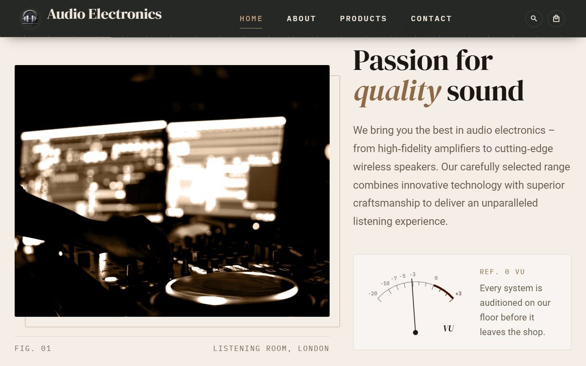
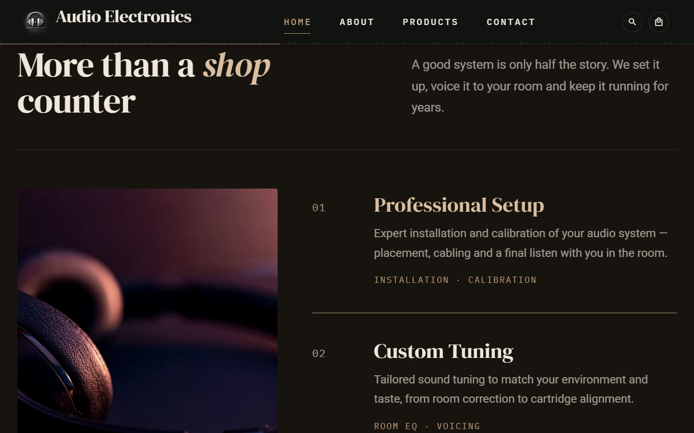
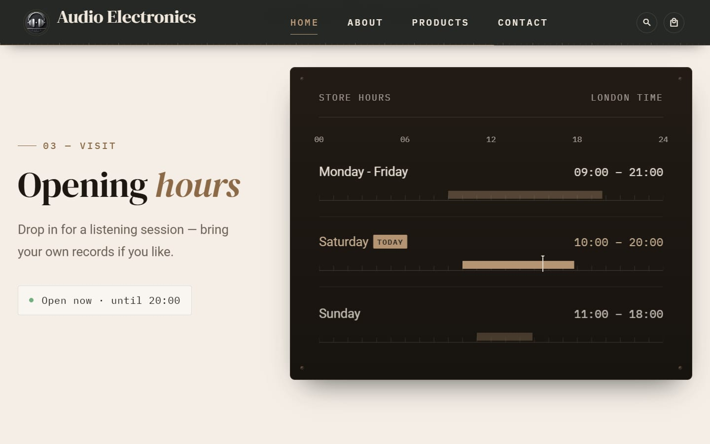
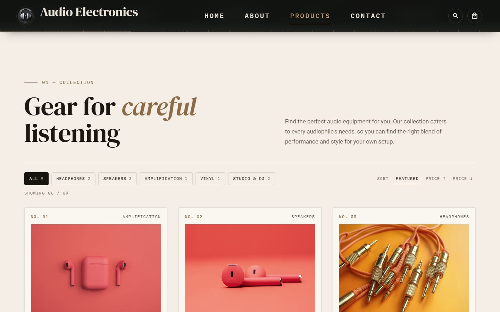
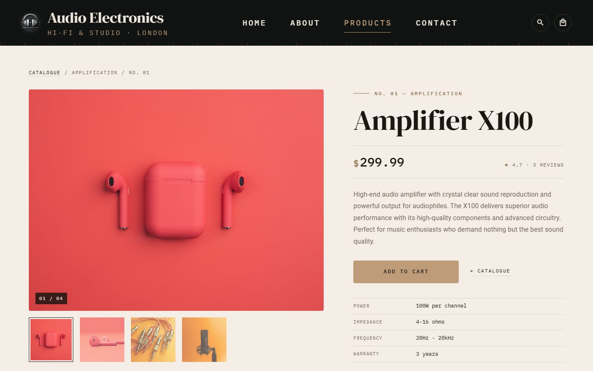
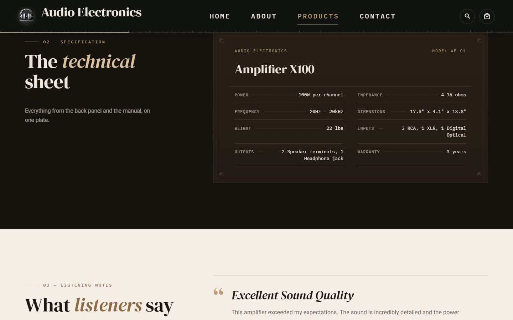
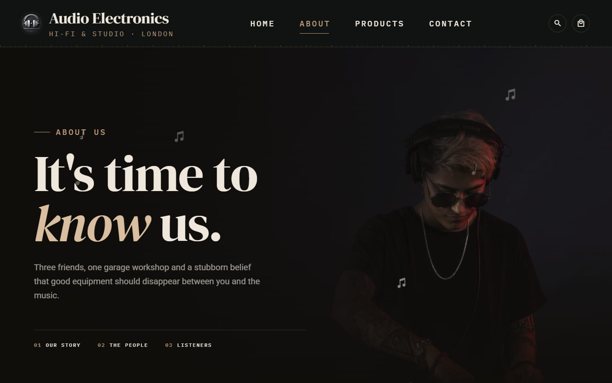
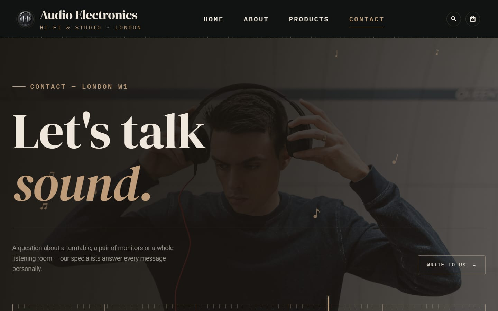
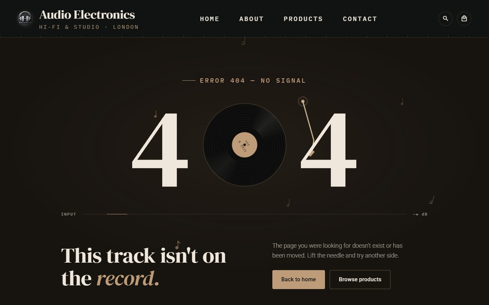
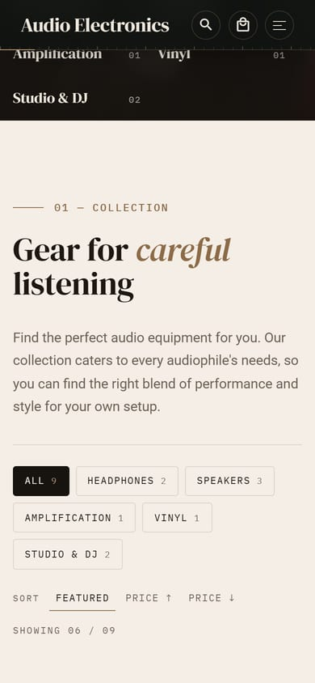

# Audio Electronics Store

A storefront for a fictional London hi-fi shop, built with Vue 3, Vite, Pinia and Vuetify.
The design is warm and analog, like a record shop: serif headings, monospace labels, brass
accents, music notes drifting in the background and a 3D vinyl record in the hero.


---

## Features

- **Five pages:** Home, About, Products (catalogue and product details), Contact and a 404 page.
- **3D hero:** a three.js vinyl record with an equalizer ring and a particle sound wave. It
  follows the mouse and scroll, and loads lazily after the page is shown.
- **Product catalogue:** 9 products with category filters and sorting. Each product has its own
  page with a gallery, a spec sheet, reviews and related products.
- **Shopping cart (Pinia):** a slide-in cart drawer. Adding a product makes its photo fly into
  the cart. Quantities are editable and the cart is saved in `localStorage`.
- **Search:** a full-screen search overlay with keyboard navigation.
- **Forms:** a contact form and a newsletter sign-up, both with validation and toast
  notifications.
- **Motion:**
  - elements reveal on scroll and pages transition smoothly;
  - product cards tilt in 3D;
  - the Home page has a VU meter and an opening-hours panel with a live "Open now" status.
- **Accessible motion:** all animations respect `prefers-reduced-motion`.
- **Responsive:** works from wide desktops down to 320px phones.

---

## Screenshots

| Home: about                                       | Home: services                                          |
| ------------------------------------------------- | ------------------------------------------------------- |
|  |  |

| Home: opening hours                                    | Product catalogue                                    |
| ------------------------------------------------------ | ---------------------------------------------------- |
|  |  |

| Product details                                           | Spec sheet                                               |
| --------------------------------------------------------- | -------------------------------------------------------- |
|  |  |

| About                                  | Contact                                    |
| -------------------------------------- | ------------------------------------------ |
|  |  |

| 404                                          | Mobile                                                                                                                       |
| -------------------------------------------- | ---------------------------------------------------------------------------------------------------------------------------- |
|  |   |

---

## Tech stack

| Area      | Tools                                                                    |
| --------- | ------------------------------------------------------------------------ |
| Framework | Vue 3 (Options API), Vue Router 4, Pinia 3                               |
| UI        | Vuetify 3 (auto-imported with `vite-plugin-vuetify`), Material Design Icons |
| 3D        | three.js                                                                 |
| Styling   | SCSS with shared design tokens                                           |
| Fonts     | DM Serif Display, Roboto, IBM Plex Mono                                  |
| Tooling   | Vite 6, ESLint, Prettier                                                 |
| Hosting   | Docker (nginx), Docker Compose                                           |

---

## Getting started

### Option 1: Docker (recommended)

The only requirement is [Docker](https://docs.docker.com/get-docker/) with Compose v2
(Docker Desktop on Windows and macOS). You don't need Node.js.

```bash
git clone https://github.com/PiotrSmola/Audio-Electronics-Store.git
cd Audio-Electronics-Store

# Linux / macOS / Git Bash
./scripts/docker-setup.sh
```

```powershell
# Windows PowerShell
.\scripts\docker-setup.ps1
```

The script checks that Docker is installed and running, builds the image, starts the
container and waits until the app responds. The app is then available at
**http://localhost:8080**.

| Bash           | PowerShell     | What it does                                    |
| -------------- | -------------- | ----------------------------------------------- |
| _(no options)_ | _(no options)_ | Production build served by nginx on port 8080   |
| `--dev`        | `-Dev`         | Vite dev server with hot reload on port 5173    |
| `--port 3000`  | `-Port 3000`   | Use a different host port                       |
| `--logs`       | `-Logs`        | Follow container logs                           |
| `--stop`       | `-Stop`        | Stop and remove the containers                  |

> If PowerShell blocks the script, run it with
> `powershell -ExecutionPolicy Bypass -File .\scripts\docker-setup.ps1`.

You can also run Docker Compose directly:

```bash
docker compose up -d --build app                 # production on http://localhost:8080
docker compose --profile dev up --build dev      # dev server on http://localhost:5173
docker compose --profile dev down                # stop everything
```

Ports can be changed with the `APP_PORT` and `DEV_PORT` environment variables.

### Option 2: Node.js

Requires **Node.js 18+** and npm.

```bash
npm install
npm run dev        # dev server on http://localhost:5173
```

| Script            | What it does                          |
| ----------------- | ------------------------------------- |
| `npm run dev`     | Start the Vite dev server             |
| `npm run build`   | Build for production into `dist/`     |
| `npm run preview` | Serve the production build locally    |
| `npm run lint`    | Run ESLint (with `--fix`)             |
| `npm run format`  | Format `src/` with Prettier           |

---

## Project structure

```text
src/
├── App.vue                 Shared layout: navbar, page transitions, footer, cart, toasts
├── main.js                 App setup (Pinia, router, Vuetify, v-reveal directive)
├── router/                 Routes, page titles, scroll behaviour, 404
├── data/products.js        Single source of product data
├── stores/cartStore.js     Cart state (persisted to localStorage)
├── components/
│   ├── NavbarComponent.vue, FooterComponent.vue, ShoppingCartComponent.vue, ToastComponent.vue
│   ├── ProductCardComponent.vue
│   ├── HeroSceneComponent.vue + hero/   Lazy-loaded three.js scene
│   └── decor/              Music notes and staff-line dividers
├── composables/            Toasts, fly-to-cart, card tilt, entrance animations
├── directives/reveal.js    Scroll-reveal directive (v-reveal)
├── views/                  Home, About, Products, Contact, NotFound (each with its SCSS)
└── assets/
    ├── img/                Optimized photos
    └── scss/               Design tokens, base styles, motion, mixins
docker/nginx.conf           nginx config with SPA fallback
scripts/                    Docker setup scripts (Bash and PowerShell)
```

---

## License

This project is licensed under the [MIT License](LICENSE).
